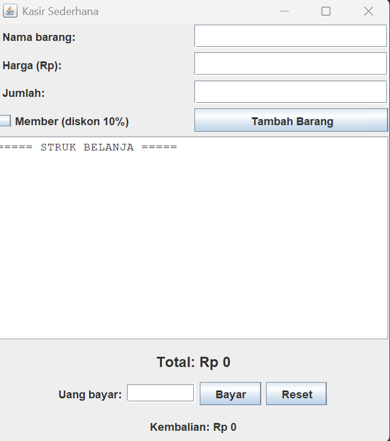
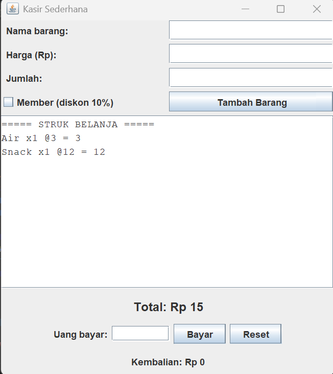
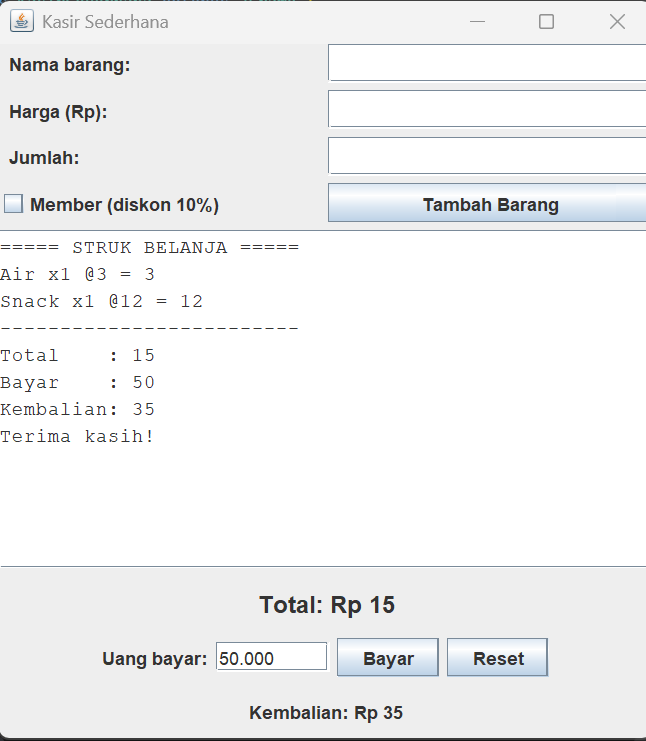

# Kasir Sederhana - GUI Java Swing
**NIM** : F1D02410131
**Nama** : Nisa Aulia Kirani
## 5 Komponen Utama GUI yang Digunakan
### 1. Top-level Container Class: `JFrame`

Jendela utama aplikasi. Class `KasirSederhana` meng-extend `JFrame`, jadi semua komponen lain ditaruh di dalamnya.

### 2. Intermediate Container Class: `JPanel` dan `JScrollPane`

- `JPanel` dipakai untuk mengelompokkan komponen: panel input barang, panel bawah (total dan kembalian), dan panel pembayaran.
- `JScrollPane` membungkus area struk supaya bisa di-scroll kalau barangnya banyak.

### 3. Atomic Component Class

- `JLabel` : label judul input, total belanja, dan kembalian
- `JTextField` : kolom nama barang, harga, jumlah, dan uang bayar
- `JButton` : tombol Tambah Barang, Bayar, dan Reset
- `JCheckBox` : pilihan member untuk diskon 10%
- `JTextArea` : area untuk menampilkan struk belanja
- `JOptionPane` : kotak dialog peringatan

### 4. Layout Classes (3 layout)

- `BorderLayout` : jendela utama (atas: input, tengah: struk, bawah: total dan pembayaran)
- `GridLayout` : panel input (4 baris, 2 kolom) dan panel bawah (3 baris)
- `FlowLayout` : baris pembayaran (label, kolom uang bayar, tombol Bayar dan Reset)

### 5. Event Listener

- `ActionListener` (interface) : klik tombol Tambah Barang, Bayar, Reset, dan centang checkbox Member
- `KeyAdapter` (adapter class) : menambah barang saat menekan tombol Enter di kolom jumlah (override `keyPressed`)

## Screenshot

**Tampilan awal**

**Setelah menambah beberapa barang**

**Setelah pembayaran**

