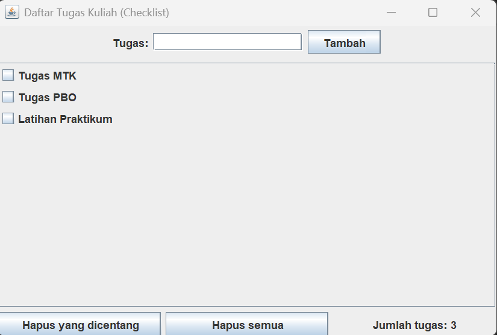
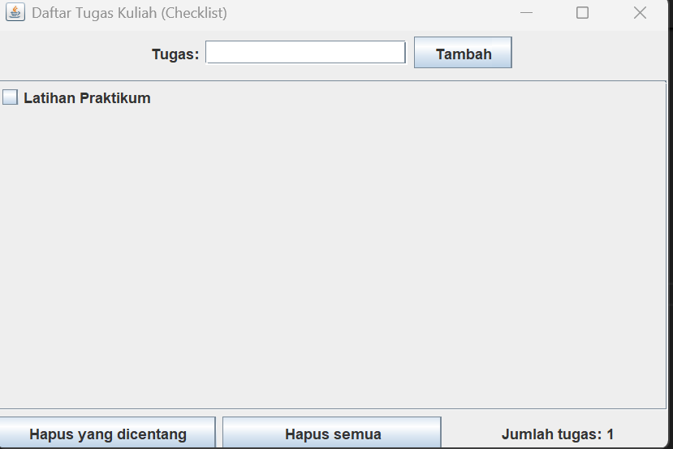

# Daftar Tugas Kuliah (Checklist) - GUI Java Swing
## Deskripsi Program
Aplikasi sederhana untuk mencatat tugas. Tugas yang ditambahkan muncul sebagai checklist, lalu tugas yang dicentang bisa dihapus sekaligus.

## 5 Komponen Utama GUI yang Digunakan
### 1. Top-level Container Class: `JFrame`
Class `DaftarTugasCek` meng-extend `JFrame`, jadi semua komponen lain ditaruh di dalamnya.

### 2. Intermediate Container Class: `JPanel` dan `JScrollPane`
- `JPanel` dipakai untuk mengelompokkan komponen: panel atas (input), panel daftar (checkbox), dan panel bawah (tombol).
- `JScrollPane` membungkus panel daftar supaya bisa di-scroll kalau tugasnya banyak.

### 2. Intermediate Container Class: `JPanel` dan `JScrollPane`

- `JPanel` dipakai untuk mengelompokkan komponen: panel atas (input), panel daftar (checkbox), dan panel bawah (tombol).
- `JScrollPane` membungkus panel daftar supaya bisa di-scroll kalau tugasnya banyak.

### 3. Atomic Component Class

- `JLabel` : teks "Tugas:" dan jumlah tugas
- `JTextField` : kolom input nama tugas
- `JButton` : tombol Tambah, Hapus yang dicentang, Hapus semua
- `JCheckBox` : checklist untuk tiap tugas
- `JOptionPane` : kotak dialog peringatan

### 4. Layout Classes (4 layout)

- `BorderLayout` : jendela utama (atas: input, tengah: daftar, bawah: tombol)
- `FlowLayout` : panel input (label, text field, tombol Tambah)
- `BoxLayout` : panel daftar, checkbox disusun ke bawah
- `GridLayout` : panel bawah (3 kolom: 2 tombol dan 1 label)

### 5. Event Listener

- `ActionListener` (interface) : klik tombol Tambah, Hapus yang dicentang, dan Hapus semua
- `KeyAdapter` (adapter class) : menambah tugas saat menekan tombol Enter (override `keyPressed`)

## Screenshot
**Tampilan awal**

**Setelah menambah tugas dan mencentang beberapa tugas**

**Setelah menghapus tugas yang dicentang**

